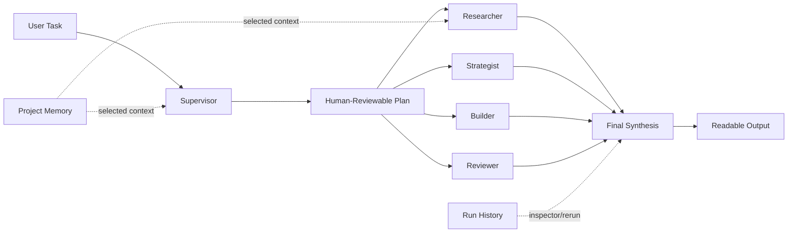
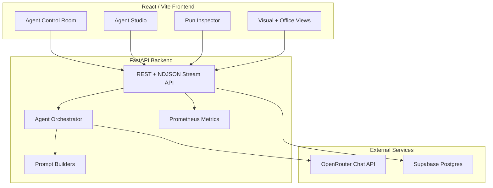

<div align="center">

# Orbis

### Agent Control Room for configurable supervisor-worker AI workflows

[](#backend)
[](#frontend)
[](#database)
[](#configuration)

Orbis turns one user task into a structured agentic workflow: a supervisor plans the work, four specialized workers execute it, and the supervisor synthesizes a final answer with logs, memory, reruns, and evaluation support.

</div>

---

## Table of Contents

- [Why Orbis](#why-orbis)
- [Core Capabilities](#core-capabilities)
- [Architecture](#architecture)
- [Tech Stack](#tech-stack)
- [Quick Start](#quick-start)
- [Configuration](#configuration)
- [Database](#database)
- [API Surface](#api-surface)
- [Validation](#validation)
- [Project Structure](#project-structure)
- [Production Notes](#production-notes)

## Why Orbis

Most AI task runners hide what happens between prompt and final answer. Orbis is built as an operational control room: you can inspect the plan, tune each agent, attach project memory, watch live logs, rerun weak steps, and compare output quality.



## Core Capabilities

| Area | What it does |
| --- | --- |
| Agent Studio | Configure worker name, role, goal, system prompt, model, temperature, token limit, and enabled state. |
| Plan Review | Preview the supervisor delegation plan, edit worker objectives, disable agents, then run. |
| Memory Layer | Store reusable project context such as company background, brand voice, and technical constraints. |
| Live Workflow Logs | Stream agent activity, tool-call events, failures, and final results through the UI. |
| Run Inspector | View model, duration, estimated tokens, estimated cost, tool calls, plan, worker outputs, and final answer. |
| Rerun / Improve | Rerun one worker or only the final synthesis without restarting the entire workflow. |
| Evaluation Lab | Score runs with a lightweight rubric for completeness, actionability, and hallucination risk. |
| Workflow Templates | Start from presets such as market research, architecture review, startup launch, UI audit, and checklist workflows. |
| Structured Outputs | Request Markdown, JSON, checklist, table, roadmap, PRD, or test-plan style final outputs. |

## Architecture

Orbis keeps backend and frontend responsibilities clearly separated.



## Tech Stack

| Layer | Tools |
| --- | --- |
| Backend | Python, FastAPI, Pydantic, HTTPX, SQLAlchemy, asyncpg, Alembic |
| Frontend | React, TypeScript, Vite, lucide-react |
| AI Provider | OpenRouter-compatible chat completions |
| Persistence | Required Supabase/Postgres with Alembic migrations |
| Observability | Structured logs, request metrics, workflow metrics, `/metrics` endpoint |
| Configuration | `.env` files, no hardcoded secrets |

## Quick Start

### Backend

```bash
cd backend
source .venv/bin/activate
pip install -r requirements.lock
cp .env.example .env
uvicorn app.main:app --reload
```

The backend starts on `http://127.0.0.1:8000` by default.

`backend/requirements.txt` remains the human-edited dependency policy file. `backend/requirements.lock` pins resolved versions for reproducible installs.

### Frontend

```bash
cd frontend
npm install
cp .env.example .env
npm run dev
```

The Vite dev server usually starts on `http://127.0.0.1:5173` or the next available port.

## Coolify Deployment

Deploy backend and frontend as separate Coolify apps.

| App | Base Directory | Dockerfile | Port | Health |
| --- | --- | --- | --- | --- |
| Backend API | `backend` | `backend/Dockerfile` | `8000` | `/health` |
| Frontend UI | `frontend` | `frontend/Dockerfile` | `80` | `/` |

Use [COOLIFY_DEPLOYMENT.md](COOLIFY_DEPLOYMENT.md) for the exact environment variables and first-run migration command.

## Configuration

Set the OpenRouter values in `backend/.env`:

```bash
APP_ENV=development
ORBIS_API_TOKEN=change_me_for_shared_or_production_access
METRICS_API_TOKEN=
OPENROUTER_API_KEY=your_openrouter_key
OPENROUTER_MODEL=openai/gpt-4.1-mini
OPENROUTER_BASE_URL=https://openrouter.ai/api/v1
CORS_ALLOW_CREDENTIALS=true
AUTH_SESSION_TTL_HOURS=720
AUTH_SESSION_CLEANUP_INTERVAL_SECONDS=900
AUTH_SESSION_TOUCH_INTERVAL_SECONDS=300
AUTH_RATE_LIMIT_MAX_ATTEMPTS=5
AUTH_RATE_LIMIT_WINDOW_SECONDS=900
AUTH_RATE_LIMIT_BACKEND=postgres
WORKFLOW_RATE_LIMIT_PER_HOUR=20
WORKFLOW_RATE_LIMIT_PER_DAY=100
WORKFLOW_MAX_CONCURRENT_PER_USER=1
RATE_LIMIT_CLEANUP_INTERVAL_SECONDS=3600
SESSION_COOKIE_NAME=orbis_session
SESSION_COOKIE_SECURE=false
SESSION_COOKIE_SAMESITE=lax
SESSION_COOKIE_DOMAIN=
SYSTEM_SETTINGS_CACHE_TTL_SECONDS=30
```

When `ORBIS_API_TOKEN` is set, it is accepted only by explicit service/diagnostic endpoints such as `/api/service/health`; it does not grant browser user or admin permissions. The public frontend never consumes this token; browser users authenticate through an `HttpOnly` cookie session and CSRF token.

## Authentication

Orbis requires database-backed register/login once `DATABASE_URL` is configured. New users are created as `guest`; admins can promote users to `vip` or `admin` from the separate `/admin` page or directly in Postgres.

Admin controls include:

- user role changes: `guest`, `vip`, `admin`
- user active/disabled state
- system enabled/disabled
- registration enabled/disabled

For the first admin on a fresh database, register normally, then promote that account in Postgres:

```sql
UPDATE users SET role = 'admin' WHERE email = 'you@example.com';
```

In production, `APP_ENV=production` requires `ORBIS_API_TOKEN` as a secure bootstrap/server token and rejects local CORS origins.
Production also requires secure cookies:

```bash
CORS_ALLOW_CREDENTIALS=true
SESSION_COOKIE_SECURE=true
SESSION_COOKIE_SAMESITE=lax
```

If frontend and backend are on completely different sites rather than subdomains of the same site, use `SESSION_COOKIE_SAMESITE=none` with HTTPS-only `SESSION_COOKIE_SECURE=true`.

Useful runtime controls:

```bash
WORKFLOW_MAX_CONCURRENCY=2
WORKFLOW_STEP_TIMEOUT_SECONDS=90
WORKFLOW_CACHE_TTL_SECONDS=0
OPENROUTER_MAX_CONNECTIONS=20
OPENROUTER_MAX_KEEPALIVE=10
OPENROUTER_RETRY_ATTEMPTS=3
LOG_LEVEL=INFO
ENABLE_METRICS=true
```

## Database

Supabase/Postgres is required. If `DATABASE_URL` is empty, still contains `[YOUR-PASSWORD]`, or cannot connect, the backend refuses to start.

```bash
DATABASE_URL=postgresql://postgres.<project-ref>:<password>@<pooler-host>:5432/postgres
DATABASE_REQUIRED=true
DATABASE_SSL=require
DATABASE_POOL_SIZE=3
DATABASE_MAX_OVERFLOW=2
DATABASE_POOL_TIMEOUT_SECONDS=10
DATABASE_AUTO_CREATE_TABLES=false
DATABASE_AUTO_MIGRATE=true
DATABASE_MIGRATION_LOCK_ID=739421317
DATABASE_MIGRATION_LOCK_TIMEOUT_SECONDS=30
DATABASE_MIGRATION_STATEMENT_TIMEOUT_SECONDS=240
```

If your database password contains reserved URL characters, URL-encode it before placing it in the connection string.

`DATABASE_SSL=require` uses certificate verification by default. Supabase poolers can require libpq-style encrypted mode without hostname verification; use `DATABASE_SSL=insecure-require` for that deployment case.

In Docker/Coolify, Orbis applies Alembic migrations in the backend entrypoint before Uvicorn starts, then disables in-process startup migration for that container. The migration runner uses a Postgres advisory lock plus bounded lock/statement timeouts so concurrent or blocked deploys fail clearly instead of hanging behind health checks.

If you operate migrations manually, set `DATABASE_AUTO_MIGRATE=false` and run:

```bash
cd backend
alembic upgrade head
```

Main persisted entities:

- `workflow_runs`
- `workflow_logs`
- `agent_profiles`
- `user_agent_profiles`
- `workflow_templates`
- `memory_items`
- `tool_calls`
- `run_evaluations`
- `security_audit_events`
- `rate_limit_counters`
- `users`
- `auth_sessions`
- `system_settings`

## API Surface

| Method | Endpoint | Purpose |
| --- | --- | --- |
| `GET` | `/health` | Minimal public uptime response: `{ "status": "ok" }`. |
| `GET` | `/metrics` | Prometheus-style metrics, protected when a metrics/API token is configured. |
| `GET` | `/api/service/health` | Service-token protected health diagnostics. |
| `POST` | `/api/auth/register` | Create a guest user and session. |
| `POST` | `/api/auth/login` | Create a session for an existing active user. |
| `GET` | `/api/auth/me` | Return current authenticated user and system settings. |
| `POST` | `/api/auth/logout` | Revoke the current cookie session. |
| `GET` | `/api/admin/health` | Admin-only provider, database, and model health. |
| `GET` / `PATCH` | `/api/admin/settings` | Admin-only system and registration switches. |
| `GET` | `/api/admin/users` | Admin-only user list. |
| `PATCH` | `/api/admin/users/{user_id}` | Admin-only role and active-state updates. |
| `GET` | `/api/admin/runs` | Admin-only all-user and legacy ownerless run summaries. |
| `GET` | `/api/admin/memories` | Admin-only all-user and legacy ownerless memories. |
| `GET` | `/api/admin/audit-events` | Admin-only security audit event list. |
| `GET` | `/api/agents` | Default supervisor-worker graph. |
| `GET` / `PUT` | `/api/agent-profiles` | Agent Studio profile configuration. |
| `GET` | `/api/templates` | Workflow template presets. |
| `GET` / `POST` | `/api/memories` | Project memory list and creation. |
| `POST` | `/api/plans` | Supervisor plan preview for human review. |
| `GET` | `/api/runs` | Persisted workflow run history. |
| `GET` | `/api/runs/{run_id}` | Full run inspector detail. |
| `POST` | `/api/runs` | Run a full workflow and return the final object. |
| `POST` | `/api/runs/stream` | Stream logs, tool calls, errors, and final result as NDJSON. |
| `POST` | `/api/runs/{run_id}/rerun/worker/{worker_id}` | Rerun one worker result. |
| `POST` | `/api/runs/{run_id}/rerun/synthesis` | Rerun only the final synthesis. |
| `POST` | `/api/evaluations/compare` | Score one or more runs with a lightweight rubric. |

Detailed health fields such as `database_status`, `database_error_code`, model, and OpenRouter configuration are available from `/api/admin/health` or `/api/service/health`, not public `/health`.

State-changing browser requests require a valid cookie session plus `X-CSRF-Token`. `Authorization: Bearer <ORBIS_API_TOKEN>` is service-scoped only and is audited on use.

## Validation

Backend:

```bash
backend/.venv/bin/python -m ruff check backend/app backend/tests backend/migrations
PYTHONPATH=backend backend/.venv/bin/python -m mypy backend/app backend/tests
PYTHONPATH=backend backend/.venv/bin/python -m pytest backend/tests
```

Frontend:

```bash
cd frontend
npm run lint
npm run build
```

## Project Structure

```text
.
|-- backend
|   |-- app
|   |   |-- agents.py             # supervisor-worker orchestration
|   |   |-- config.py             # environment-driven settings
|   |   |-- db.py                 # Supabase/Postgres repository
|   |   |-- main.py               # FastAPI routes and streaming
|   |   |-- metrics.py            # lightweight metrics registry
|   |   |-- openrouter_client.py  # OpenRouter HTTP client
|   |   |-- prompts.py            # centralized prompt builders
|   |   |-- security.py           # password hashing and session token helpers
|   |   `-- schemas.py            # API and orchestration models
|   |-- migrations                # Alembic schema migrations
|   `-- tests                     # backend regression tests
|-- frontend
|   `-- src
|       |-- App.tsx               # dashboard and workflow UI
|       |-- api.ts                # typed API client
|       |-- styles.css            # dashboard styling
|       `-- types.ts              # frontend API types
|-- about_project.md
|-- progress.md
`-- troubleshooting.md
```

## Production Notes

- Keep secrets only in environment variables.
- Put the FastAPI app behind Nginx or another reverse proxy.
- Keep `DATABASE_AUTO_MIGRATE=true` for simple Docker/Coolify deployments; the backend container runs migrations before serving traffic.
- Tune `WORKFLOW_MAX_CONCURRENCY` according to VPS size and OpenRouter rate limits.
- Keep `DATABASE_POOL_SIZE` small for Supabase pooler-backed deployments.
- Monitor `/metrics`, workflow duration, provider errors, and database latency.
- For larger traffic, move workflow execution into a queue-backed worker process.

## License

MIT. See [LICENSE](LICENSE).
